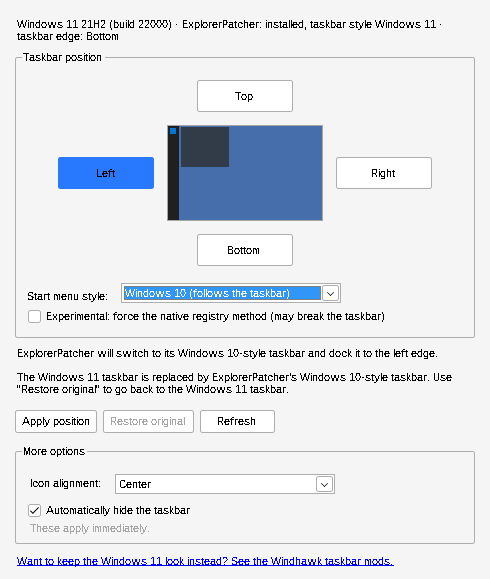

# Start Bar Controller

A small Windows app for customizing the taskbar. Its main job is moving the taskbar to the
**top, left, right or bottom** of the screen, with the **start menu following it**, on
Windows 11, where Microsoft removed that option.



## What it can do (v0.1 MVP)

| Feature | How |
|---|---|
| Move the taskbar to any edge | Windows 10: natively. Windows 11: through [ExplorerPatcher](https://github.com/valinet/ExplorerPatcher) (see below) |
| Start menu follows the taskbar | ExplorerPatcher's Windows 10 start menu, which opens next to the taskbar on every edge |
| Icon alignment (left / center) | Native Windows 11 setting; applies immediately |
| Auto-hide the taskbar | Win32 `SHAppBarMessage`; applies immediately |
| Restore original | Every value is backed up before the first change, and **Restore original** puts it back |
| Command line | `StartBarController --edge top`, etc. (see below) |

No administrator rights needed: everything it changes is in `HKEY_CURRENT_USER`.

## Why Windows 11 needs ExplorerPatcher

Windows 11 replaced the taskbar with a new one that only supports the bottom edge:

| Windows version | Bottom | Top | Left / Right |
|---|---|---|---|
| Windows 10 | ✅ | ✅ native | ✅ native |
| Windows 11 21H2 (build 22000) | ✅ | ⚠️ native, but the start menu and flyouts still open at the bottom | ❌ needs ExplorerPatcher |
| Windows 11 22H2, 23H2, 24H2 and later | ✅ | ❌ needs ExplorerPatcher | ❌ needs ExplorerPatcher |

The registry value Explorer uses for the taskbar edge (`StuckRects3`) is still there, but
from 22H2 on the Windows 11 taskbar ignores it. Making the *native* Windows 11 taskbar dock to
another edge means injecting code into `explorer.exe` and hooking its internals. That's a large,
fragile project that breaks with Windows updates, so it's out of scope for this MVP.

Instead the app works with **ExplorerPatcher** (free, open source, widely used). It brings back
the Windows 10 taskbar, which supports every edge and has a start menu that opens next to it.
Start Bar Controller detects ExplorerPatcher, sets its taskbar style for you, writes the edge,
and restarts Explorer. If ExplorerPatcher isn't installed, **Get ExplorerPatcher…** installs it
with `winget` or opens its download page.

Notes:
- With ExplorerPatcher, the taskbar looks and behaves like Windows 10's.
  **Restore original** brings back the Windows 11 taskbar.
- On Windows 11 24H2 and later the Windows 10 *start menu* no longer exists, so the Windows 11
  start menu stays. ExplorerPatcher still provides the movable taskbar there (its own
  "Windows 10 (ExplorerPatcher)" taskbar style, which the app picks automatically).
- Some antivirus products flag ExplorerPatcher as a false positive.
- If you'd rather keep the Windows 11 look, the [Windhawk taskbar mods](https://ramensoftware.com/windhawk-mods-for-the-windows-11-taskbar)
  ("Taskbar on top", "Vertical taskbar") move the native taskbar. As of their last description,
  the start menu still opens at the bottom with those.
- **Experimental: force the native registry method** writes the edge even where Windows 11
  doesn't support it, if you want to see what your build does. Use **Restore original** if the
  taskbar breaks.

## Getting the program (from a Mac or anywhere)

There's no installer. It's one `.exe`.

1. On GitHub, open this repo's **Actions** tab → latest **Build** run → *Artifacts*.
2. Download **StartBarController-win-x64** (self-contained, about 70 MB, runs on any Windows 10/11 x64).
   **StartBarController-win-x64-framework-dependent** is about 0.2 MB but needs the
   [.NET 8 Desktop Runtime](https://dotnet.microsoft.com/download/dotnet/8.0).
3. Copy it to the Windows PC and run it. Windows SmartScreen may warn because the exe is
   unsigned: *More info → Run anyway*.

Pushing a tag such as `v0.1.0` also publishes both files as a GitHub Release.

## Using it

1. Pick an edge with the **Top / Left / Right / Bottom** buttons. The preview and the text
   below it show what will happen on your Windows version.
2. If ExplorerPatcher is driving the taskbar, choose **Start menu style → Windows 10 (follows
   the taskbar)** so the start menu opens next to it.
3. Click **Apply position**. Explorer restarts (open File Explorer windows close), and the
   taskbar comes back on the new edge.

**Restore original** undoes everything this app changed. The backup is stored in
`%LOCALAPPDATA%\StartBarController\backup.json`.

### Command line

```
StartBarController --status
StartBarController --edge <top|bottom|left|right> [--start-menu <keep|win10|win11>] [--force-native] [--no-restart]
StartBarController --align <left|center>
StartBarController --autohide <on|off>
StartBarController --restore [--no-restart]
```

`--edge`, `--align` and `--autohide` can be combined. The exit code is `1` when the requested
edge isn't possible on this system, and `2` for bad arguments.

## How it works

- The taskbar edge is byte 12 of the binary value
  `HKCU\Software\Microsoft\Windows\CurrentVersion\Explorer\StuckRects3\Settings`
  (0 = left, 1 = top, 2 = right, 3 = bottom). Each monitor's copy under `MMStuckRects3` is updated too.
- Explorer only reads it at startup, so the app **kills** Explorer and lets Windows restart it.
  A clean shutdown would make Explorer save its current position over the new one.
- ExplorerPatcher settings: `HKCU\Software\ExplorerPatcher\OldTaskbar` (taskbar style) and
  `HKCU\...\Explorer\Advanced\Start_ShowClassicMode` (start menu style).
- Icon alignment: `HKCU\...\Explorer\Advanced\TaskbarAl` (and ExplorerPatcher's `OldTaskbarAl`).

## Building from source

Requires the .NET 8 SDK. The Windows app can be compiled on macOS or Linux too
(`EnableWindowsTargeting` is set), though it only runs on Windows.

```
dotnet test tests/StartBarController.Core.Tests
dotnet publish src/StartBarController.App -c Release -r win-x64 --self-contained true -p:PublishSingleFile=true
```

Project layout:

- `src/StartBarController.Core`: platform-neutral logic. It decides what's possible
  (`PositionPlanner`), edits `StuckRects3`, handles backup and restore, and parses the command line.
  Fully unit-tested.
- `src/StartBarController.App`: the Windows Forms UI plus the Windows-only pieces (registry
  access, restarting Explorer, auto-hide).
- `tests/StartBarController.Core.Tests`: xUnit tests that run on any OS against an in-memory registry.

## Ideas for later

- Taskbar size / small icons, combine-buttons mode, hiding Search / Task View / Widgets buttons
- Per-monitor positions
- Profiles (save and switch whole taskbar setups), tray icon with quick switching
- Optional Windhawk integration for keeping the native Windows 11 taskbar

## Disclaimer

This tool edits per-user Explorer settings and restarts Explorer. It's tested against the
documented behavior and in Wine, but not on every Windows build. If something looks wrong,
use **Restore original** (or `StartBarController --restore`).
ExplorerPatcher is a separate project by a different author.
